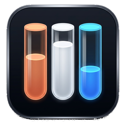

<p align="center">
  
</p>

<h1 align="center">QuotaTank</h1>

<p align="center">
  Claude Code, OpenAI Codex CLI ve Google Antigravity CLI kotalarını<br/>
  sıvı dolu tanklar olarak gösteren Windows masaüstü uygulaması.
</p>

---

## Neler yapar?

- **Tek bakışta kota:** Her aracın haftalık kotası bir tank, içindeki parlak katman ise bu 5 saatlik dönemde harcayabileceğin kısım.
- **Küçük pencere (widget):** Sağ altta her zaman üstte duran kompakt görünüm. Boyutu köşesinden çekilerek ayarlanır, yeri hatırlanır, saydam yapılabilir, istenirse tıklamalar içinden geçer.
- **Bildirimler:** Bir kota azalınca (varsayılan %20 ve %10) ve azalmış bir kota yenilenince Windows bildirimi.
- **"Ne zaman biter?" tahmini:** Şimdiki kullanım hızıyla kotanın yenilenmeden önce bitip bitmeyeceği.
- **"Şimdi hangi aracı kullanayım?" önerisi:** En çok hakkı kalan aracı gösterir.
- **5 saat / haftalık oranı:** 5 saatlik tam bir dönemin haftalık kotanın ne kadarını yediğini kullanımından öğrenir ve bir aralık olarak gösterir (ör. "%14, %10–17 arası").
- **Tepsi simgesi:** Köşesindeki renkli nokta durumu gösterir (yeşil / sarı / kırmızı), üzerine gelince kalan yüzdeler yazar.
- **Kısayol:** `Ctrl + Shift + Q` ile küçük pencere her yerden açılır/kapanır (Ayarlar'dan değiştirilebilir).
- **Windows ile başlama** (isteğe bağlı).

Ekstra token harcamaz ve hiçbir veri bilgisayarından dışarı çıkmaz. Kota bilgisi araçların kendi yerel çıktılarından okunur.

## Gereksinimler

- Windows 10 veya 11
- [Python 3.10+](https://www.python.org/downloads/) (kurarken **"Add python.exe to PATH"** işaretle)
- [Node.js](https://nodejs.org) (Claude Code ve Antigravity kotalarını yakalamak için)
- İzlemek istediğin CLI araçları kurulu ve giriş yapılmış olmalı: `claude`, `codex`, `agy`. Hangileri kuruluysa onlar görünür; diğerlerini Ayarlar'dan kapatabilirsin.

## Kurulum

1. Bu sayfada **Code → Download ZIP** ile indir ve bir klasöre çıkar (ya da `git clone`).
2. Klasördeki **`kurulum.bat`** dosyasına çift tıkla.

Kurulum Python ortamını hazırlar, gerekli paketleri yükler, Claude Code / Antigravity bağlantısını kurar, masaüstüne **QuotaTank** kısayolu ekler ve uygulamayı açar.

> Claude Code ve Antigravity kotaları, o araçları bir sonraki kullanışında (bir mesaj gönderdiğinde) görünmeye başlar. Codex kotası hemen gelir.

## Nasıl çalışır?

| Araç | Veri kaynağı |
| --- | --- |
| **Claude Code** | `~/.claude/settings.json` içindeki `statusLine` köprüsü (`five_hour`, `seven_day` limitleri) ve `~/.claude/stats-cache.json` |
| **Codex CLI** | `codex app-server` üzerinden yerel JSON-RPC (`account/rateLimits/read`) |
| **Antigravity CLI** | `~/.gemini/antigravity-cli/settings.json` içindeki `statusLine` köprüsü |

`statusLine` köprüsü, araçların zaten ürettiği durum satırı verisini yakalayıp bir kopyasını kaydeder. Daha önce kendi durum satırın varsa (ör. bir powerline), veri ona da aynen iletilir; görünümün bozulmaz.

## Bağlantıyı geri alma

Claude Code / Antigravity ayarlarını kurulumdan önceki haline döndürmek için:

```powershell
.venv\Scripts\python.exe install_hooks.py --uninstall
```

Ayarlar dosyaları değiştirilmeden önce yanlarına `.bak-tarih` uzantılı yedek alınır.

## Testler

```powershell
.venv\Scripts\python.exe -m unittest discover -s tests
```

---

### English (short)

QuotaTank is a Windows desktop app that shows your Claude Code, OpenAI Codex CLI and Google Antigravity CLI usage limits as liquid tanks, with a compact always-on-top widget, low-quota notifications, depletion forecasts and a tray icon. Requirements: Windows 10/11, Python 3.10+, Node.js. Install: download the repo and double-click `kurulum.bat`. Everything runs locally and costs no tokens.
